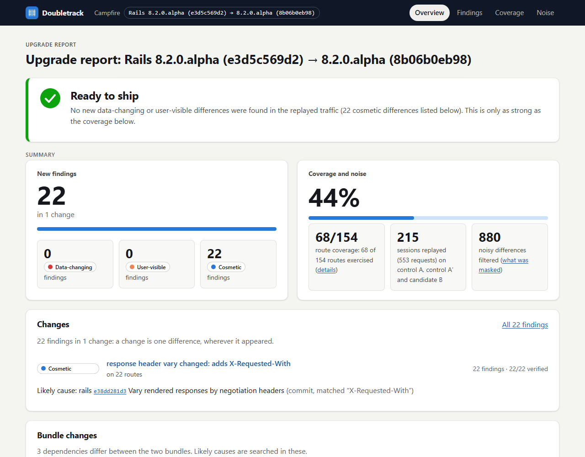
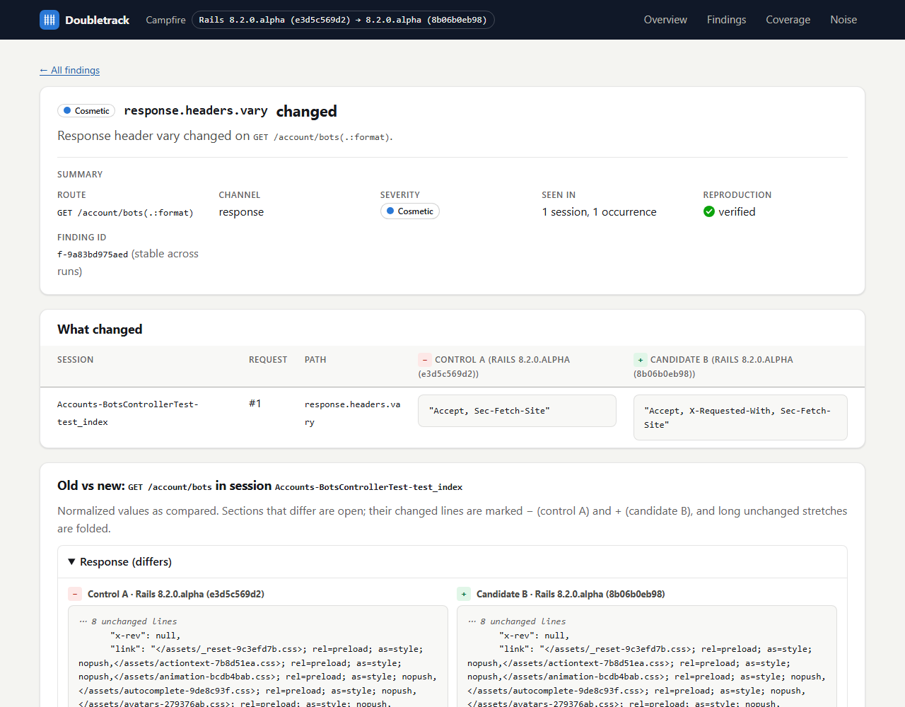

# Doubletrack

**Upgrade Rails with proof, not hope.**

[](https://github.com/JoshBlazer/doubletrack/actions/workflows/ci.yml)
[](LICENSE)


Your test suite tells you the app still passes on the next Rails. It doesn't tell you
what the app now *does* differently: a header it sends, a row it writes, a job it
enqueues, an email it renders.

Doubletrack boots your app on the current and the next Rails side by side, replays the
same traffic through both, and reports every difference in behavior. Each finding comes
with a generated test that passes on today's Rails and fails on the next one.

<a href="https://joshblazer.github.io/doubletrack/campfire-pr423/"></a>

<sub>The [published report](https://joshblazer.github.io/doubletrack/campfire-pr423/) for a real Rails upgrade, below.</sub>

## Seen on a real upgrade

[basecamp/once-campfire PR #423](https://github.com/basecamp/once-campfire/pull/423)
moved Campfire from Rails main `e3d5c569` to `8b06b0eb`. It changed only the lockfile,
pulled in a Rails security release, and said the bump breaks nothing. Campfire's ~650
tests passed on both sides.

Doubletrack captured 553 requests from those tests and replayed them on both lockfiles:

* **No data-changing or user-visible differences.** The PR's claim held for the
  replayed traffic.
* **One change the PR didn't mention:** every negotiated response now sends
  `Vary: Accept, X-Requested-With, …`. Doubletrack reports it as **one change seen on 22
  routes**, and names its likely cause, found offline in Bundler's clone of Rails:
  [rails/rails@e38dd281d3](https://github.com/rails/rails/commit/e38dd281d340d28bda39877ee83665f092091de2),
  "Vary rendered responses by negotiation headers" (GHSA-r9jg-fmfx-2gv6). Browsers don't
  care. A shared cache in front of the app now keys pages on one more header, and
  Campfire caches complete pages itself.
* **Proven, not asserted:** all 22 generated Minitest tests pass on Campfire's old
  lockfile and fail on the new one, run against Campfire itself. Three random seeds give
  the same 22 findings.

[Report](https://joshblazer.github.io/doubletrack/campfire-pr423/) · [Walkthrough](docs/walkthroughs/m6.md) (including the six
Doubletrack bugs this app exposed, and their fixes) · [Note to the maintainers](https://github.com/basecamp/once-campfire/pull/423#issuecomment-6667493665)

## What you get

* **Behavior, not pass/fail.** It compares HTTP responses (status, headers, and bodies
  as JSON or HTML structure), SQL writes, enqueued *and performed* jobs, mail, cache
  writes and outbound HTTP calls.
* **Noise separated by design.** Two controls run the current Rails (A and A′) next to
  the candidate on the next Rails (B). Anything that differs between A and A′, such as
  tokens, timestamps or random ids, is masked and listed. It is never reported as an
  upgrade change.
* **One change, one line, with its likely cause.** A framework change that touches every
  route is reported once ("adds X-Requested-With, on 22 routes"), and Doubletrack names the
  commit, changelog entry or source file in your upgraded dependencies that mentions it.
  It searches only what's already on your machine.
* **A failing test for every finding.** Each finding gets a minimized reproduction
  (RSpec or Minitest). Doubletrack runs it during the run, and marks the finding
  *verified* only if it passes on current and fails on next.
* **Built from the tests you already have.** `doubletrack capture` turns your
  integration tests and request specs into replay sessions. You can also write
  sessions by hand.
* **A summary on every Rails-bump PR.** The GitHub Action runs Doubletrack in CI, posts
  the summary on the PR, and attaches the report.
* **A verdict you can gate on.** Findings are ranked data-changing, user-visible or
  cosmetic. The report says *Ready to ship* or *Not ready to ship*, and the exit code
  tells CI the same.
* **Expected changes, recorded once.** `doubletrack accept <id> --reason "..."` writes
  a committed baseline. Later runs report only what's new.
* **Local and private.** The report is static HTML that works offline. There's no
  network, no telemetry and no account, and your app's code is never modified.

<details>
<summary>What a finding looks like</summary>



</details>

## Try it in two minutes

The repository includes a small dual-boot app (Rails 8.0 → 8.1) with one real
difference:

```sh
git clone https://github.com/JoshBlazer/doubletrack && cd doubletrack
bundle install && make fixtures
bundle exec exe/doubletrack run fixtures/apps/shop --seed 42 --baseline tmp/demo-baseline.yml
```

```console
Booting control A, control A′ (Gemfile) and candidate B (Gemfile.next)...
  [########################] 5/5 sessions  done
Verifying reproductions for 1 new finding...
Doubletrack 20261103T203131Z-42: Shop, Rails 8.0.5.1 → 8.1.4
  5 sessions, 14 requests replayed on control A, control A′ and candidate B
  Findings: 1 new in 1 change  (data-changing 0, user-visible 1, cosmetic 0)
    [user-visible] exception.message: "unexpected token at ''" → "unexpected end of input at line 1 column 1"  (GET /orders/:id(.:format), c-8a5d176afec2)
      likely cause: json ext/json/ext/parser/parser.c appears in 3.1.0 (the current bundle hadn't loaded it at boot)
  Reproductions: 1 verified, 0 not verified (minitest, .../repro/test/doubletrack)
  Noise filtered: 0 (0 A/A′ differences observed)
  Route coverage: 7 of 11 routes (64%)
  Verdict: Not ready to ship
  Report: .../tmp/doubletrack/20261103T203131Z-42/report/index.html
```

That finding is real. When the shop parses an empty response body, Rails 8.0's bundle
raises `unexpected token at ''`, and Rails 8.1's bundle, which pins `json 3.1.0`, raises
`unexpected end of input at line 1 column 1`. The generated test shows it:

```console
$ REPRO=$PWD/fixtures/apps/shop/tmp/doubletrack/20261103T203131Z-42/repro/test/doubletrack/f-bb3068808cf1_test.rb
$ (cd fixtures/apps/shop && bundle exec ruby -Itest $REPRO)
1 runs, 1 assertions, 0 failures, 0 errors, 0 skips
$ (cd fixtures/apps/shop && BUNDLE_GEMFILE=Gemfile.next bundle exec ruby -Itest $REPRO)
--- expected
+++ actual
@@ -1 +1 @@
-"unexpected token at ''"
+"unexpected end of input at line 1 column 1"
1 runs, 1 assertions, 1 failures, 0 errors, 0 skips
```

If the change is expected, accept it and the next run is clean:

```console
$ bundle exec exe/doubletrack accept c-8a5d176afec2 --reason "We never show JSON parser messages to users" \
    --baseline tmp/demo-baseline.yml fixtures/apps/shop
$ bundle exec exe/doubletrack run fixtures/apps/shop --seed 42 --baseline tmp/demo-baseline.yml
  Findings: 0 new  (data-changing 0, user-visible 0, cosmetic 0), 1 accepted in demo-baseline.yml
  Verdict: Ready to ship                                                 # exit 0
```

Exit codes: `0` no new differences, `1` new differences found, `2` Doubletrack itself
failed. Full output is in [`docs/walkthroughs/m4.md`](docs/walkthroughs/m4.md).

## Use it on your app

You need a Rails app on SQLite or PostgreSQL 13+ with a `db/schema.rb`, and Linux or
macOS (on Windows, use WSL).

**Install.** Version 0.1.0 is ready but not yet published to rubygems.org. Until it is,
build it from this repository:

```sh
git clone https://github.com/JoshBlazer/doubletrack && cd doubletrack
gem build doubletrack.gemspec && gem install ./doubletrack-0.1.0.gem
```

(Once published: `gem install doubletrack`.)

**Then, in your app:**

```sh
doubletrack init --to 8.1 --install   # writes Gemfile.next for the next Rails; never edits Gemfile
doubletrack doctor                    # checks the setup and boots both versions
doubletrack capture                   # sessions from your integration tests and request specs
doubletrack run                       # replay, compare, verify, report
```

`init` copies your `Gemfile` to `Gemfile.next` with only the rails line changed, and
`Gemfile.lock` to `Gemfile.next.lock`, so Bundler moves only Rails and what it needs. If
your Gemfile already uses the [`next_rails`](https://github.com/fastruby/next_rails)
`next?` convention, it links to it instead. `doctor` names each problem it finds with a
fix:

```console
$ doubletrack doctor
Doubletrack doctor: /home/me/campfire
  ok    platform: x86_64-linux
  ok    ruby: Ruby 4.0.9
  ok    dual boot: Gemfile + Gemfile.lock, Gemfile.next + Gemfile.next.lock
  ok    rails versions: 8.2.0.alpha (e3d5c569d2) → 8.2.0.alpha (8b06b0eb98)
  ok    bundles: both bundles are installed
  ok    database: SQLite (sqlite3), db/schema.rb
  ok    http clients: no HTTP clients that bypass Net::HTTP
  ok    sessions: 1 session file
  ok    git: git available (likely causes can name commits)
  ok    boot: control A booted Rails 8.2.0.alpha (e3d5c569d2) in 9.1 s, candidate B Rails 8.2.0.alpha (8b06b0eb98) in 10.4 s
Ready: run `doubletrack capture`, then `doubletrack run`.
```

Capture writes `doubletrack/sessions/captured.jsonl` in your app. Hand-written sessions
go in the same folder ([format](docs/formats/session.md)), and canned responses for
outbound HTTP go in `doubletrack/http_stubs.json`. An optional `doubletrack.yml`
configures the run (see `lib/doubletrack/config.rb`).

Results, the report and the generated tests go to `path/to/app/tmp/doubletrack/`.
Doubletrack writes nothing else into your app, except `doubletrack.baseline.yml` when
you run `doubletrack accept`.

To run the generated tests in your app, add the gem to the test group of the shared
`Gemfile`, so both bundles have it:

```ruby
gem "doubletrack", require: false, group: :test
# until 0.1.0 is on rubygems.org: gem "doubletrack", github: "JoshBlazer/doubletrack", require: false, group: :test
```

## On every Rails-bump PR (GitHub Action)

```yaml
# .github/workflows/doubletrack.yml
on:
  pull_request:
    paths: ["Gemfile*"]
permissions:
  contents: read
  pull-requests: write          # only for comment: "true"
jobs:
  doubletrack:
    runs-on: ubuntu-latest
    steps:
      - uses: actions/checkout@v7
      - uses: ruby/setup-ruby@v1
        with:
          bundler-cache: true
      - uses: JoshBlazer/doubletrack@main   # pin a tag or commit once released
        with:
          fail-on: user-visible     # data-changing | user-visible | any | never
          comment: "true"           # one PR comment, updated on every push
```

The action installs Doubletrack from its own source, captures sessions from your tests,
runs, and writes a Markdown summary to the job summary (and the PR comment): the verdict,
each change with where it was seen, how many reproduced, and its likely cause. The full
report is uploaded as the `doubletrack-report` artifact. The app's Ruby, system libraries
and `Gemfile.next` (see `doubletrack init`) come from your workflow. Details:
[`docs/design/action.md`](docs/design/action.md).

## How it works

```
              sessions: captured from your tests, or hand-written
                                    │
                           ┌────────┴────────┐
                           │   coordinator   │  normalize · diff · noise mask
                           │                 │  severity · repro · report
                           └──┬─────┬─────┬──┘
        NDJSON over fds 3/4   │     │     │
             ┌────────────────┘     │     └────────────────┐
             ▼                      ▼                      ▼
        control A              control A′             candidate B
     Gemfile (current)      Gemfile (current)     Gemfile.next (next)
```

Each Rails version runs in its own process (a *twin*) with its own `BUNDLE_GEMFILE`. The
coordinator talks to the twins over dedicated pipes, so nothing the app prints can
corrupt the protocol. Before each session every twin restores the same database
snapshot, freezes the clock and seeds `rand`. Mail, jobs and outbound HTTP are recorded,
not sent. Differences between the two controls are noise; differences that only the
candidate shows are findings. See [`docs/ARCHITECTURE.md`](docs/ARCHITECTURE.md).

## Status

**Pre-alpha.** Milestones M0–M12 are done: capture, three-way replay, diff and noise
mask, report, verified reproductions, baseline, the real-world run above, changes with
likely causes, `init`/`doctor`, a GitHub Action, PostgreSQL apps, a Ruby per side, and capture fidelity
and parallel replay. Next: publishing 0.1.0 ([roadmap](docs/ROADMAP.md)). Version 0.1.0 is packaged
and checked in CI, but not yet published to rubygems.org. It supports SQLite and PostgreSQL apps.

Every capability below names the command that proves it. A row is ✅ only if that
command passes; "CI" marks whether it has also been seen green in GitHub Actions.

<details>
<summary>Full status table</summary>

| Capability | Milestone | Status | Proof | CI |
|---|---|---|---|---|
| Gem skeleton, CLI `help`/`version`, exit codes | M0 | ✅ | `bundle exec rspec spec/doubletrack/cli_spec.rb` | ✅ [run 41553435904](https://github.com/JoshBlazer/doubletrack/actions/runs/41553435904) |
| Protocol: envelope, NDJSON framing, timeouts, binary bodies | M0 | ✅ | `bundle exec rspec spec/doubletrack/protocol` | ✅ [run 41553435904](https://github.com/JoshBlazer/doubletrack/actions/runs/41553435904) |
| Twin lifecycle: clean env, stdout isolation, crash/hang detection | M0 | ✅ | `bundle exec rspec spec/doubletrack/coordinator` | ✅ [run 41553435904](https://github.com/JoshBlazer/doubletrack/actions/runs/41553435904) |
| `shop` fixture dual-boots Rails 8.0 / 8.1 | M0 | ✅ | `cd fixtures/apps/shop && bin/rails test && BUNDLE_GEMFILE=Gemfile.next bin/rails test` | ✅ [run 41553435904](https://github.com/JoshBlazer/doubletrack/actions/runs/41553435904) |
| **Twins talk: one request to each version** | **M0** | ✅ | `bin/doubletrack-spike fixtures/apps/shop` and `bundle exec rake spec:integration` | ✅ [run 41553435904](https://github.com/JoshBlazer/doubletrack/actions/runs/41553435904) |
| Lint (standardrb) | M0 | ✅ | `bundle exec rake standard` | ✅ [run 41553435904](https://github.com/JoshBlazer/doubletrack/actions/runs/41553435904) |
| Gem builds | M0 | ✅ | `gem build doubletrack.gemspec` | ✅ [run 41553435904](https://github.com/JoshBlazer/doubletrack/actions/runs/41553435904) |
| Outbound HTTP blocked and recorded (`Net::HTTP`), no socket opened | M1 | ✅ | `bundle exec rspec spec/doubletrack/recorder` | ✅ [run 41556339580](https://github.com/JoshBlazer/doubletrack/actions/runs/41556339580) |
| **Side-effect recorder: traces with response, SQL writes, jobs, mail, cache, HTTP** | **M1** | ✅ | `bundle exec rake spec:integration` (`spec/integration/recorder_spec.rb`, both Rails versions) | ✅ [run 41556339580](https://github.com/JoshBlazer/doubletrack/actions/runs/41556339580) |
| Frozen clock, session loader, trace normalizer (property-tested) | M2 | ✅ | `bundle exec rspec spec/doubletrack/twin spec/doubletrack/session_spec.rb spec/doubletrack/normalize` | ✅ [run 41592499206](https://github.com/JoshBlazer/doubletrack/actions/runs/41592499206) |
| **Session replay: snapshots, frozen time, seeded rand, cookies, jobs performed inline; same session twice → identical normalized traces** | **M2** | ✅ | `bundle exec rake spec:integration` (`spec/integration/replay_spec.rb`, both Rails versions) | ✅ [run 41592499206](https://github.com/JoshBlazer/doubletrack/actions/runs/41592499206) |
| Normalizers (JSON, HTML, SQL), structural diff, noise mask, severity, fingerprint, clustering (property-tested) | M3 | ✅ | `bundle exec rspec spec/doubletrack/normalize spec/doubletrack/diff` | ✅ [run 41595451702](https://github.com/JoshBlazer/doubletrack/actions/runs/41595451702) |
| Static report: overview, findings, detail, coverage, noise; offline, no-JS | M3 | ✅ | `bundle exec rspec spec/doubletrack/report` | ✅ [run 41595451702](https://github.com/JoshBlazer/doubletrack/actions/runs/41595451702) |
| Report accessibility: axe (WCAG 2.1 A/AA rules), 0 violations on every page | M3 | ✅ (CI only) | `report-a11y` CI job | ✅ [run 41595451702](https://github.com/JoshBlazer/doubletrack/actions/runs/41595451702) |
| **`doubletrack run` on shop: three-way replay → findings + report** | **M3** | ✅ | `make run-shop`, `spec/integration/run_spec.rb` | ✅ [run 41595451702](https://github.com/JoshBlazer/doubletrack/actions/runs/41595451702) |
| **Precision/recall eval: planted 9/9, precision 1.00, clean 0 findings** | **M3** | ✅ | `make eval`, `spec/integration/eval_spec.rb` | ✅ [run 41595451702](https://github.com/JoshBlazer/doubletrack/actions/runs/41595451702) |
| Repro helper, spec writer (RSpec/Minitest), minimizer, baseline file | M4 | ✅ | `bundle exec rspec spec/doubletrack/repro_spec.rb spec/doubletrack/specgen spec/doubletrack/baseline_spec.rb spec/doubletrack/results_spec.rb` | ✅ [run 41714163293](https://github.com/JoshBlazer/doubletrack/actions/runs/41714163293) |
| **Generated spec passes on old and fails on new (RSpec and Minitest, run for real); `accept` suppresses the finding on the next run** | **M4** | ✅ | `bundle exec rake spec:integration` (`spec/integration/repro_spec.rb`) | ✅ [run 41714163293](https://github.com/JoshBlazer/doubletrack/actions/runs/41714163293) |
| **Eval: every planted finding's repro passes on 8.0 and fails on 8.1 (13/13)** | **M4** | ✅ | `make eval`, `spec/integration/eval_spec.rb` | ✅ [run 41714163293](https://github.com/JoshBlazer/doubletrack/actions/runs/41714163293) |
| Capture probe, record builder, assembler (grouping, redaction, dedupe), `fixtures` snapshot sessions | M5 | ✅ | `bundle exec rspec spec/doubletrack/capture spec/doubletrack/session_snapshot_spec.rb` | ✅ [run 41717869635](https://github.com/JoshBlazer/doubletrack/actions/runs/41717869635) |
| **`doubletrack capture` on shop: one session per request-making test; `run` replays them with capture fidelity 13/13** | **M5** | ✅ | `bundle exec rake spec:integration` (`spec/integration/capture_spec.rb`, capture on both Rails versions) | ✅ [run 41717869635](https://github.com/JoshBlazer/doubletrack/actions/runs/41717869635) |
| Hardening after a review of M0–M5: generated-spec escaping and strictness, exit codes, twin pipes and paths, capture grouping, config validation | post-M5 | ✅ | `bundle exec rake` and `bundle exec rake spec:integration` (each fix has a spec named after it) | ✅ [run 41733480715](https://github.com/JoshBlazer/doubletrack/actions/runs/41733480715) |
| Real-world run: once-campfire PR #423 captured (215 sessions, 553 requests) and replayed on Ruby 4.0.9 → 22 verified findings, 0 unverified, same ids on seeds 42/7/1234; all 22 generated tests pass on Campfire's current Rails and fail on the PR's | M6 | ✅ (local) | `doubletrack capture` + `doubletrack run --seed 42` on a once-campfire checkout ([walkthrough](docs/walkthroughs/m6.md) §2) | ✅ [run 42082544994](https://github.com/JoshBlazer/doubletrack/actions/runs/42082544994) (the Doubletrack fixes; the Campfire run itself is local) |
| Published report + maintainers contacted + upstream issues | M6 | ✅ | [report on Pages](https://joshblazer.github.io/doubletrack/campfire-pr423/) (`gh-pages` branch, local paths replaced with `/app`); [comment on #423](https://github.com/basecamp/once-campfire/pull/423#issuecomment-6667493665), [comment on #287](https://github.com/basecamp/once-campfire/pull/287#issuecomment-6667886815) | – |
| Changes and likely causes: findings grouped across routes into changes; each change names the dependency commit, changelog entry or source that mentions it, offline; `accept c-…`. Campfire: 22 findings → 1 change, likely cause Rails `e38dd281d3`; shop: names `json`; eval: 13 changes, none mixing two plants | M7 | ✅ | `bundle exec rspec spec/doubletrack/diff spec/doubletrack/attribution_spec.rb`, `bundle exec rake spec:integration` (`spec/integration/repro_spec.rb`), `make eval`; Campfire: [walkthrough](docs/walkthroughs/m7.md) | ✅ [run 42110238868](https://github.com/JoshBlazer/doubletrack/actions/runs/42110238868) |
| `init` and `doctor`; 0.1.0 packaged: `init --to 8.1 --install` dual-boots a copy of shop that had none, `doctor` passes it (both versions booted) and fails a broken setup with a fix; the built gem installed into an empty directory runs and captures shop | M8 | ✅ | `bundle exec rspec spec/doubletrack/setup_spec.rb spec/doubletrack/doctor_spec.rb`, `bundle exec rake spec:integration` (`spec/integration/setup_spec.rb`), `script/installed_gem_check`; [walkthrough](docs/walkthroughs/m8.md) | ✅ [run 42114755002](https://github.com/JoshBlazer/doubletrack/actions/runs/42114755002) |
| GitHub Action and Markdown summary: `summary.md` with every run; the action (`uses: ./`) on shop gives verdict `not_ready`, 1 change, 1 finding, its summary matches `findings.json`/`run.json`, and `fail-on: user-visible` fails the step | M9 | ✅ | `bundle exec rspec spec/doubletrack/report/markdown_spec.rb`; CI job `action on shop` (`script/check_action_outputs`); [walkthrough](docs/walkthroughs/m9.md) | ✅ [run 42116504407](https://github.com/JoshBlazer/doubletrack/actions/runs/42116504407) |
| PostgreSQL apps: each twin on a private database, snapshots as template databases; shop on PostgreSQL 17 gives the same finding id as on SQLite, A/A′ identical, the repro passes on 8.0 and fails on 8.1 run for real, no databases left | M10 | ✅ | `bundle exec rspec spec/integration/postgresql_spec.rb` with `BUNDLE_WITH=postgresql SHOP_DATABASE_URL=…`; [walkthrough](docs/walkthroughs/m10.md) | ✅ [run 42240059573](https://github.com/JoshBlazer/doubletrack/actions/runs/42240059573) |
| A Ruby per side: `ruby`/`next_ruby` (default: `.ruby-version` when installed); shop with candidate B on another Ruby still finds its verified change; Campfire boots on 4.0.9 from its `.ruby-version` with Doubletrack on 3.4.12 | M11 | ✅ | `bundle exec rspec spec/doubletrack/ruby_locator_spec.rb`, `spec/integration/rubies_spec.rb` with `DOUBLETRACK_NEXT_RUBY=…`; [walkthrough](docs/walkthroughs/m11.md) | ✅ [run 42243141650](https://github.com/JoshBlazer/doubletrack/actions/runs/42243141650) |
| Capture fidelity and scale: raw bodies, uploads and hosts captured and replayed (shop fidelity 100%; Campfire skips 26 → 0); `--parallel N` slots give the same finding ids (Campfire replay 79.5 s → 38.5 s with 2 slots) | M12 | ✅ | `bundle exec rake spec:integration` (`capture_spec.rb`, `run_spec.rb`); [walkthrough](docs/walkthroughs/m12.md) | ✅ [run 42247996914](https://github.com/JoshBlazer/doubletrack/actions/runs/42247996914) |

CI runs lint, unit specs on Ruby 3.2/3.3/3.4/4.0, the integration specs (M0–M5 exit checks) on Ruby 3.4, `make eval`, axe on a generated report, and a gem build.

</details>

## Limitations

The ones most likely to matter:

* **SQLite and PostgreSQL 13+** only; MySQL isn't supported. On PostgreSQL, each session's
  database restore costs time (about 2 s per session on a laptop).
* **Coverage comes from your sessions.** System tests, model tests and Action Cable
  aren't replayed. The report shows route coverage, and a verdict is only as strong as
  that coverage.
* **Rubies are found, not installed.** Each side runs on its own Ruby (the app's
  `.ruby-version` by default), which must already be installed. Supported upgrades are
  adjacent minor versions from Rails 7.1 to 8.1; the Campfire run shows two revisions of
  Rails main work too.
* **Only `Net::HTTP`-based clients are intercepted** for outbound HTTP.
* **Likely causes are text matches,** shown with their evidence: a lead to check, not a
  proof.
* **Linux and macOS only.** On Windows, use WSL.

<details>
<summary>All limitations</summary>

* **Coverage comes from your sessions.** `doubletrack capture` covers what your
  integration tests and request specs exercise. It doesn't cover system tests
  (browser-driven), model tests, or requests made outside the integration session
  (ADR 0025). A report is only as strong as its route coverage, and the report shows
  it.
* **Captured sessions replay what the test sent, not what the test stubbed.** App-level
  stubs (for example swapping a client object), `sign_in` helpers that skip requests,
  and test-only setup don't carry over. Capture fidelity shows each request whose
  replay status differs from its test (ADR 0027). Outbound HTTP needs
  `doubletrack/http_stubs.json`.
* **Redaction is value-based.** Capture redacts the values of secret-looking
  environment variables. A secret that's hard-coded in a test, or absent from the
  capture environment, isn't caught.
* **Reproduction specs compare strictly.** A generated spec checks the old value with
  `eql` (RSpec) or `Doubletrack::Repro.same?` (Minitest), as strictly as the run
  verified it: `1` and `1.0` differ.
* **Reproduction specs replay through Doubletrack, not `rails_helper`** (ADR 0022). Each
  one boots a separate process of your app in the `doubletrack` environment, so it
  matches what the run saw. It isn't an idiomatic request spec, and turning it into one
  is up to you. The first repro in a test process pays one app boot (a few seconds).
* **Minimization is greedy.** It drops whole earlier requests one at a time (ADR 0023),
  not params or stubs, and the result isn't guaranteed minimal. Verifying repros adds
  replays to the run: on the planted app, 5.6 s against a 2.0 s replay.
* **Repro snapshots are binary SQLite files** built from your schema (and seeds, if
  enabled). Copying a repro into your repo means committing that file.
* **The baseline matches on the fingerprint** (ADR 0024). An accepted finding also
  covers later changes of the same kind at the same place. For example, a string that
  changes to a different value next time stays accepted. Values at enumerated leaves
  (status codes, job classes, queue names and so on) are part of the fingerprint, so a
  different status change is a new finding.
* **Small eval corpus.** "9/9, precision 1.00" is measured on one planted app with 9
  version-gated plants (ADR 0020). It isn't a general accuracy claim.
* **Diff granularity.** Array diffs are index-based, so one extra SQL write early in a
  request can shift later paths into several findings. All changes inside an HTML page
  become one finding per route. A framework change that affects every route gives one
  finding per route.
* **Noise masking can hide real changes** at a path that was also noisy between the two
  controls. Masked paths are always listed on the report's noise page.
* **Error pages:** twins render your production error pages
  (`consider_all_requests_local = false`, ADR 0021), not Rails' debug page.
* **Outbound HTTP:** only clients built on `Net::HTTP` are intercepted (ADR 0012).
  `httpx`, `curb`/`typhoeus` and raw sockets are **not** intercepted yet. Unstubbed
  `Net::HTTP` calls get a synthetic 503.
* **Jobs are performed inline**, right after the request that enqueued them (ADR 0014),
  at most 25 per request. That ordering differs from a real queue. Turn it off with
  `perform_jobs: false`.
* **Control A also builds the snapshot.** Loading the schema, seeds and fixtures runs in
  control A's process, so anything the app memoizes at class level while doing that
  exists in A but not in A′ or B. A difference between A and A′ caused by it would be
  treated as noise (masked), not reported.
* **Uploads in captured sessions** are embedded as base64, 5 MB per file at most (ADR 0039).
* **Parallel slots** (`--parallel N`, ADR 0040) run 3 × N app processes; memory grows with N.
* **Very large responses:** a response body over about 48 MB doesn't fit in one protocol
  frame. The run stops with an error naming the twin, instead of comparing it.
* **Determinism has limits** (ADR 0015). `SecureRandom` isn't controlled, and time read
  by SQLite itself (`CURRENT_TIMESTAMP`) isn't frozen. In-memory Ruby state that survives
  between sessions (memoized class variables) isn't reset; only the database, cache, mail
  and job queues are.
* **Cache:** twins use a fresh `:memory_store` (ADR 0011), whatever store your app
  configures.
* **SQLite and PostgreSQL 13+** (M10, ADR 0037). MySQL apps aren't supported. PostgreSQL
  twins each get a private database; a crashed twin can leave `dt_…` databases behind.
* **No native Windows.** Linux and macOS only; Windows via WSL.
* **A Ruby per side** (M11, ADR 0038): `ruby` / `next_ruby` (default: the app's
  `.ruby-version` when installed). Rubies are found among rbenv, asdf, mise, chruby, rvm and
  CI tool-cache installs, never installed; each bundle must be installed for its Ruby.
* **No browser behavior.** JavaScript and system tests with real browsers are out of
  scope.
* **Rails 7.1 → 8.1, adjacent minor versions only** (ADR 0008). Only the 8.0 → 8.1 pair
  has a fixture so far.
* The twin runs in a `doubletrack` Rails environment built from your `test` environment
  (ADR 0009). Code that branches on `Rails.env.test?` will see `false`.
* Snapshots are built from `db/schema.rb` (optionally plus `db/seeds.rb`).
  `structure.sql` apps and multiple databases aren't supported yet. Each session restores
  the template in place through SQLite's backup API (ADR 0029).

</details>

## Privacy

No telemetry, no accounts, no network calls. Reports are static files. Nothing leaves
your machine.

## AI assistance

Doubletrack is built with an AI coding assistant (Claude Code) and reviewed by the
author, JoshBlazer, who owns every commit. Modules that started from a design note and
tests written before the implementation:

| Module | Design note | Tests first? |
|---|---|---|
| Protocol (`lib/doubletrack/protocol/`) | [`docs/design/protocol.md`](docs/design/protocol.md) | Design note first; specs written alongside the code in the same session (not strictly before) |
| Recorder (`lib/doubletrack/recorder/`) | [`docs/design/recorder.md`](docs/design/recorder.md) | Design note and the integration exit-check spec first (run red: 12/12 failing); interceptor/converter unit specs written alongside the code |
| Replay: snapshots, clock, sessions, normalizer (`lib/doubletrack/twin/`, `session.rb`, `normalize/`) | [`docs/design/replay.md`](docs/design/replay.md) | Yes: design note, then the exit-check and unit specs committed red before the implementation |
| Diff, noise mask, clustering, severity, report, eval (`diff/`, `normalize/{json,html,sql}.rb`, `report/`, `eval/`) | [`docs/design/diff.md`](docs/design/diff.md) | Yes: design note, then all specs and both integration exit checks committed red; two later fixes (debug error pages, HTML clustering) also started from a failing spec |
| Reproduction specs and baseline (`specgen/`, `repro.rb`, `baseline.rb`) | [`docs/design/specgen.md`](docs/design/specgen.md) | Yes: design note and formats, then unit and integration specs committed red (`edcd8be`) |
| Test-derived capture (`capture/`, `capture.rb`) | [`docs/design/capture.md`](docs/design/capture.md) | Yes: design note and ADRs, then unit and integration specs committed red (`dcdc24d`) |
| Hardening after a review of M0–M5 (generated-spec escaping and strictness, exit codes, twin pipes, paths) | Findings of three independent review passes, listed in `docs/PROGRESS.md` | Yes: one failing spec per finding committed red first |

The design notes in this repository were drafted with the assistant from the author's
written brief and reviewed by the author.

## License

MIT. See [LICENSE](LICENSE).
